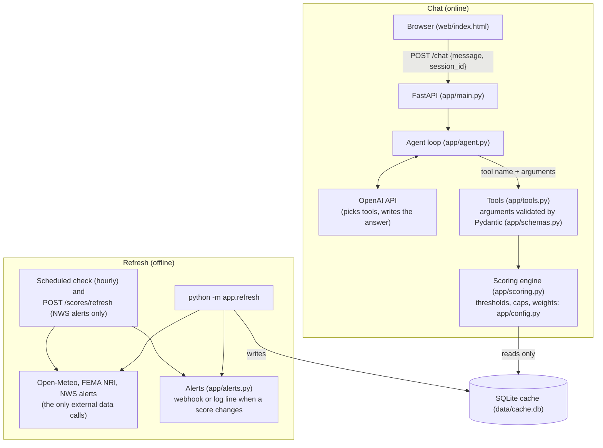

# Design

How the Weather Risk Intelligence Agent is built, and why. Setup, assumptions and limitations are in [README.md](README.md).

## The core rule

**The LLM doesn't compute numbers.** Deterministic Python code computes every score, statistic and ranking. The LLM does two things: it picks which tool to call, and it explains the tool's result in words.

An LLM is good at understanding a question and bad at arithmetic it can't show. An analyst deciding where to invest needs numbers that are the same every time and can be traced to their inputs. So the two jobs are split.

## Architecture



There are two separate paths, refresh and chat, plus an alert step on the refresh path:

- **Refresh (offline, run by hand).** `python -m app.refresh` fetches the weather history, the NRI rows and the active NWS alerts for all 14 hubs, stores the raw responses, then computes the scores and stores one snapshot per hub. It fetches everything before writing anything, in one transaction, so a failed request leaves the existing cache untouched.
- **Alerts (bonus).** The NWS-only refresh fetches just the NWS alerts, the one source that changes from hour to hour. It runs from a background task in the server (right after startup, then every 60 minutes; in a thread, so chat isn't blocked) and from `POST /scores/refresh`; a lock keeps the two from overlapping. Every refresh also computes a `current_risk` per hub (the highest severity among its active NWS alerts, mapped to 0–100 in `app/config.py`), compares both scores with the hub's previous snapshot, and sends each change that crosses its threshold to `ALERT_WEBHOOK_URL`, or logs it if the URL is empty (`app/alerts.py`). `current_risk` is kept apart from the exposure score, which is stable by design. The agent can report the cached alerts through the `current_alerts` tool, always with their fetch time, but never uses `current_risk` in a ranking.
- **Chat (online).** A question goes to the agent. Everything it needs is read from the cache; no weather, NRI or NWS API is called. The only network call is to OpenAI.

### One chat turn

1. The agent sends the system prompt, the session's history and the new message to the LLM, with the six tool schemas.
2. The LLM replies with tool calls. Code validates the arguments, runs the tools and sends the results back.
3. Step 2 repeats, at most 5 times. After that the LLM must answer with what it has.
4. The LLM returns a final answer in the `AgentAnswer` schema.
5. Code checks the answer (see "Guardrails"). If it passes, the turn is added to the session history and returned.

### Tools

| Tool | Purpose |
|---|---|
| `list_hubs(region)` | Which hubs and regions we cover |
| `rank_hubs(category, region, top_n)` | Hubs ranked by one category's score, or by the overall score |
| `compare_hubs(hub_ids, categories)` | Side-by-side scores with breakdowns, and who is highest per category |
| `explain_hub_score(hub_id)` | One hub's full breakdown, its rank among all hubs, and its categories ordered by contribution |
| `weather_stat(hub_id, metric, year)` | Days in one year passing a weather threshold, as a count and a percentage |
| `current_alerts(hub_ids, region)` | The NWS alerts active at each hub when the cache was last refreshed, each hub's `current_risk`, and the fetch time |

Tool results carry the comparisons too (ranks, "highest per category", categories by contribution), so the LLM never has to compare or derive numbers itself.

### The final answer

`AgentAnswer` (in `app/schemas.py`):

| Field | Content |
|---|---|
| `answer` | The text shown to the user |
| `hubs` | The hubs the answer is about: `{hub_id, name, score}` |
| `key_figures` | The numbers the answer relies on: `{label, value, unit, source_tool}` |
| `assumptions` | The definitions and assumptions behind the answer |
| `confidence`, `confidence_reason` | high / medium / low, and why |
| `out_of_scope` | True if the question can't be answered from our hubs and data |

The chat page shows `answer`, and puts the tools used, key figures, assumptions and confidence in a collapsible "How I got this" panel.

### Guardrails

| Guardrail | Where | What it does |
|---|---|---|
| Strict tool schemas | `schemas.py`, `tools.py` | Hub ids, categories, metrics and years are enums built from `hubs.json` and `config.py`. The LLM can't ask for a hub or a year that doesn't exist. |
| Argument re-validation | `tools.run_tool` | Pydantic validates the arguments again before any code acts on them. An error goes back to the LLM as a tool result so it can correct itself. |
| Structured output | `agent._ask_llm` | The final answer must match the `AgentAnswer` JSON schema (OpenAI structured outputs). |
| Runtime number check | `agent.unsupported_key_figures` | Every `key_figures` value must appear in a tool result from the session. If one doesn't, the answer is rejected and the LLM is asked again, with the unsupported values named. |
| One retry, then an error | `agent.run_turn` | An answer that fails the schema or the number check is retried once. If it fails again, the user gets an error object, never unvalidated text. |
| System-prompt rules | `agent.SYSTEM_PROMPT` | Use only numbers from tool results; state when a question is out of scope; check a question's premise against the data; list assumptions; state the fetch time of any alert, and keep `current_risk` out of rankings. |

The number check covers `key_figures`, not the prose in `answer`. That limit is listed in the README.

## Repository structure

```
Weather-Risk-Agent/
├── README.md            # how to run, assumptions, limitations
├── DESIGN.md            # this file
├── PLAN.md              # the build plan and the decisions made at each gate
├── CLAUDE.md            # working rules for Claude Code
├── requirements.txt     # six pinned dependencies
├── .env.example         # OPENAI_API_KEY, OPENAI_MODEL, ALERT_WEBHOOK_URL (optional)
├── data/
│   ├── hubs.json        # the 14 hubs: id, city, state, region, county, FIPS, lat, lon
│   ├── cache.db         # created by refresh; not in git
│   └── simulated.db     # created by scripts/simulate_alert.py; not in git
├── app/
│   ├── config.py        # every path, threshold, cap and weight
│   ├── db.py            # SQLite: the API cache and the score snapshots
│   ├── refresh.py       # fetch the data, compute and store the scores, alert on changes
│   ├── sources/
│   │   ├── open_meteo.py   # daily weather history per hub
│   │   ├── fema_nri.py     # NRI row per county
│   │   └── nws.py          # active NWS alerts per hub
│   ├── scoring.py       # the deterministic scoring engine and weather statistics
│   ├── alerts.py        # current risk from NWS alerts; webhook or log on a change
│   ├── schemas.py       # Pydantic models: tool arguments and AgentAnswer
│   ├── tools.py         # the six tools and their JSON schemas
│   ├── agent.py         # the LLM loop, the system prompt, the terminal chat
│   └── main.py          # FastAPI routes; serves the chat page; runs the scheduled alert check
├── scripts/
│   └── simulate_alert.py   # demo: a SIMULATED alert on a copy of the database
├── web/
│   └── index.html       # the chat page: plain HTML and JavaScript, no build step
└── evals/
    ├── cases.json       # the eleven agent cases and their checks
    ├── run.py           # the eval runner
    └── results.json     # the most recent run
```

The dependencies point one way: `main` → `agent` → `tools` → `scoring` → `db`. `config.py` is imported by all of them and imports nothing from the app. `refresh.py` is the only code that calls `sources/`; `main` imports it for `POST /scores/refresh` and the scheduled check. `tools` also reads the cached alerts through `alerts.py`.

## Scoring model

Five hazard categories, each scored 0–100 per hub, plus an overall score. Higher means more exposed.

| Category | NRI hazards | Weather metrics (yearly average, 2021–2025) |
|---|---|---|
| winter | winter weather, ice storm, cold wave | snow days (≥ 1 cm), severe-cold days (Tmin ≤ −18 °C) |
| hurricane | hurricane | none |
| flood | inland flooding, coastal flooding | heavy-rain days (≥ 50 mm) |
| severe_storm | tornado, hail, strong wind | none |
| heat | heat wave | extreme-heat days (Tmax ≥ 38 °C) |

```
NRI part       = mean over the category's hazards of  min(annualized frequency / cap, 1) × 100
weather part   = mean over the category's metrics of  min(days per year / cap, 1) × 100
category score = 0.5 × NRI part + 0.5 × weather part      (100% NRI where there is no weather metric)
overall score  = weighted mean of the five category scores (equal weights)
```

The cap values are listed in the README and set in `app/config.py`.

### Worked example: Denver, winter

From `explain_hub_score("denver")`:

| Input | Value | Cap | Scaled |
|---|---|---|---|
| NRI winter weather | 13.738 per year | 40 | 34.3 |
| NRI ice storm | 0.016 per year | 2 | 0.8 |
| NRI cold wave | 1.263 per year | 20 | 6.3 |
| **NRI part** (mean) | | | **13.8** |
| Snow days | 22.4 per year | 30 | 74.7 |
| Severe-cold days | 7.4 per year | 30 | 24.7 |
| **Weather part** (mean) | | | **49.7** |
| **Winter score** (50/50) | | | **31.7** |

Each step is computed from unrounded values and rounded only when reported. Re-adding the rounded parts by hand can therefore differ by 0.1, as it does here (0.5 × 13.8 + 0.5 × 49.7 = 31.75).

### Why it is built this way

- **Two sources per category.** NRI gives a long-term, county-level view of how often a hazard occurs. Open-Meteo gives what was observed at the hub's own coordinates in the last five years. Each covers a weakness of the other: NRI is coarse in space, and five years of weather is short in time.
- **Fixed caps, not min-max scaling across hubs.** With min-max, adding or removing a hub would change every other hub's score. With a fixed cap, a hub's score depends only on its own data, and it can be explained in one line: "22.4 snow days a year against a cap of 30 gives 74.7".
- **NRI annualized frequency (`AFREQ`), not the NRI risk score.** Frequency is the closest NRI measure to "how often could this hub be disrupted". The NRI risk score also mixes in the county's social vulnerability and community resilience, and expected annual loss depends on the value of the county's buildings, population and agriculture. Neither describes a hub's exposure. The trade-off: frequency says how often, not how severe.
- **NRI caps at the national 99th percentile.** Frequencies have very different ranges by hazard, so each hazard needs its own cap. One rule sets them all: a county in the national top 1% for a hazard scores 100.
- **No wind-gust metric.** Gridded reanalysis smooths peak gusts: no hub averaged more than 1 day a year with gusts ≥ 93 km/h, so the metric was dropped. Hurricane and severe storm therefore use NRI alone. Refresh still fetches the daily gust values, and the NRI risk and expected-loss fields that were compared when choosing the NRI field; the cache holds them, but the score doesn't use them.
- **Snow days in the score use ≥ 1 cm, not 0.25 cm.** "Did it snow?" and "did snow disrupt operations?" are different questions. The 0.25 cm threshold answers the first and is used for weather statistics; 1 cm is our judgment call for the second.
- **Rankings sort on unrounded scores.** Two hubs that round to the same score still rank in their true order. Exact ties keep `hubs.json` order.

## Storage: SQLite

One file, `data/cache.db` (or the file named by the `CACHE_DB_PATH` environment variable), with two tables:

| Table | Columns | Content |
|---|---|---|
| `api_cache` | `source, cache_key, fetched_at, payload_json` | The raw API response per hub (Open-Meteo, NWS) or per county (NRI). A refresh replaces it. |
| `score_snapshots` | `hub_id, computed_at, overall, breakdown_json, current_risk` | One row per hub per refresh. Rows are appended, so they form a score history. |

**Why SQLite.** It is a single file with no server, it ships with Python, and it is more than enough for 14 hubs. It is also easy to open and inspect. Postgres would add setup with no benefit at this size.

**Why store anything.** Without a cache, every question would call the external APIs again: slow, exposed to rate limits (a full fetch can hit Open-Meteo's free-tier limit), and broken whenever an API is down.

**What is not in the database.**
- The hub list and the scoring settings are version-controlled files (`data/hubs.json`, `app/config.py`), so a change to them shows up in git.
- Chat sessions are kept in memory and lost on restart.
- The database file itself is not in git. `python -m app.refresh` rebuilds it.

**How scores are served.** The tools recompute scores from the cached raw data on each call, using the current `config.py`. With 14 hubs this is fast (a full ranking takes well under a second), and it means a config change takes effect without a refresh. The `score_snapshots` table is a history written at refresh time; the app reads it for the last-refresh time in `GET /health`, and each refresh reads the previous row per hub to detect changes.

## Why no agent framework

The agent uses the OpenAI Python SDK directly. There is no LangChain or other framework.

- **The loop is small.** The whole agent (loop, retries, number check, sessions) is one file, `app/agent.py`, of about 250 lines, including the system prompt.
- **Every step is visible.** There is no hidden prompt, no hidden retry and no hidden state. What is sent to the LLM is exactly what is in the file, so each step can be read, explained and debugged.
- **The custom parts are the point.** The number check, and the rule that a failed turn leaves the session history untouched, are specific to this design. In a framework they would have to be fitted around its abstractions.
- **The SDK already does the generic work.** It turns the Pydantic models into strict JSON schemas, for both the tools and the final answer, and parses the reply back into them.
- **Fewer dependencies.** Six pinned packages in total.

The cost: no built-in tracing, streaming or persistent memory. For a single-agent loop with six tools, that trade is worth it.

## Evals

`python -m evals.run` runs two layers and saves the results to `evals/results.json`.

- **Layer A: three deterministic checks, no LLM.** A snowfall percentage recounted from the raw cached days equals the tool's value; Midwest rankings contain only Midwest hubs, in descending order, within 0–100; scoring twice gives identical results.
- **Layer B: eleven agent cases, run against the real LLM and checked by code.** No LLM grades another LLM. The cases are the four assignment questions, a follow-up, an unknown hub, a false premise, a top-3 question, a forecast question, one more statistic and an active-alerts question.

Expected values are never written into the cases. Each check asks the scoring engine for the right value at run time, so the evals stay correct when the data or the config changes. Every Layer B case also checks that the answer is a valid `AgentAnswer` and that every `key_figures` value appears in a tool result.

What the evals don't show is listed under Limitations in the README.
