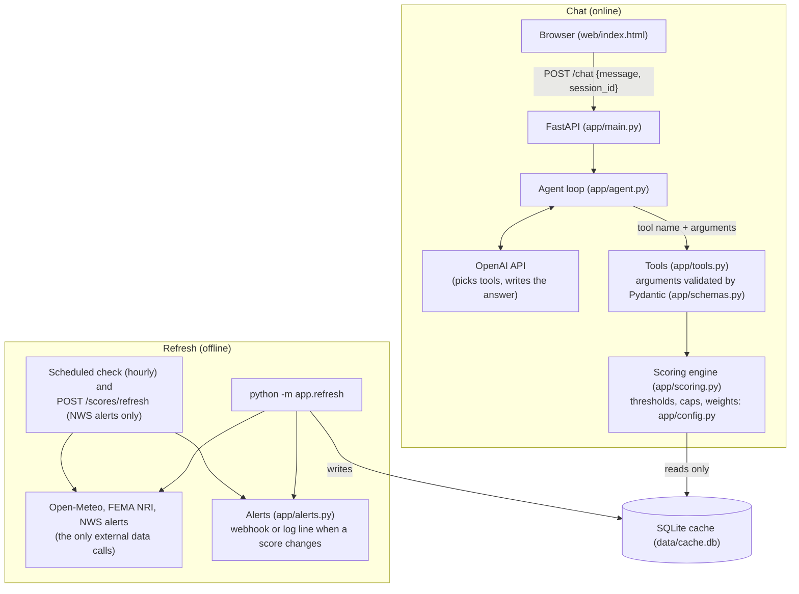

# Weather Risk Intelligence Agent

A chat agent that helps logistics analysts decide which US distribution hubs are most exposed to severe weather, and so should come first for resilience investment.

**Live demo:** https://weather-risk-agent-h81t.onrender.com/ (the free instance sleeps after 15 minutes without traffic, so the first request can take up to a minute.)

- It covers a fixed list of 14 hubs (`data/hubs.json`).
- It scores each hub's historical exposure, 0–100, in five hazard categories (winter, hurricane, flood, severe storm, heat) and overall.
- It answers rankings, comparisons, weather statistics, "why is this hub's score high?" questions and follow-ups.
- **The LLM doesn't compute numbers.** Python code computes every score, statistic and ranking. The LLM picks which tool to call and explains the result.

Data: Open-Meteo daily weather history (2021–2025) and the FEMA National Risk Index (county level, December 2025 release). Both are free and need no key. A separate, live signal uses the National Weather Service's active alerts (see "Alerts").

The design is explained in [DESIGN.md](DESIGN.md). The build plan and its decisions are in [PLAN.md](PLAN.md).

## How it works

Two separate paths: refresh fetches the data into a SQLite cache, and chat answers questions from that cache.



Each part is explained in [DESIGN.md](DESIGN.md#architecture).

## Setup

You need Python 3 (built and run on 3.14; older versions are untested) and an OpenAI API key.

```bash
git clone https://github.com/Coral3la/Weather-Risk-Agent.git
cd Weather-Risk-Agent

# 1. Virtual environment and dependencies
python3 -m venv .venv
source .venv/bin/activate
pip install -r requirements.txt

# 2. Configuration
cp .env.example .env
# Open .env and fill in:
#   OPENAI_API_KEY=<your key>
#   OPENAI_MODEL=<a model that supports structured outputs and tool calling; built and evaluated with gpt-4o>
# ALERT_WEBHOOK_URL is optional: where risk-change alerts are POSTed. Empty = alerts are logged.

# 3. Fetch the data and compute the scores (required)
python -m app.refresh

# 4. Start the server
uvicorn app.main:app
# Open http://localhost:8000
```

**Step 3 is required.** The database (`data/cache.db`) isn't in git; refresh creates it. Refresh is the only command that calls the weather, NRI and NWS APIs. It needs no API key. If refresh hits Open-Meteo's free-tier rate limit, it prints "Open-Meteo rate limit reached; waiting …" and retries after the wait the API asks for.

After the refresh, the chat reads only from the cache; its only network call is to OpenAI. Separately, while the server runs it re-fetches the NWS alerts once an hour (see "Alerts").

### Other commands

| What | Command |
|---|---|
| Chat in the terminal instead of the browser | `python -m app.agent` |
| Run the evals | `python -m evals.run` |
| Check the NWS alerts now | `curl -X POST http://localhost:8000/scores/refresh` |
| Demo an alert with simulated data | `python -m scripts.simulate_alert` (see "Alerts") |

### Environment variables

| Variable | Where | What |
|---|---|---|
| `OPENAI_API_KEY`, `OPENAI_MODEL` | `.env` | Required for the chat and the evals. |
| `ALERT_WEBHOOK_URL` | `.env` | Optional. Where alerts are POSTed; empty = logged. |
| `CACHE_DB_PATH` | the command line | Optional. Use another database file instead of `data/cache.db`, e.g. `CACHE_DB_PATH=data/simulated.db ALERT_CHECK_INTERVAL_MINUTES=0 uvicorn app.main:app` for the simulated copy (the scheduled check is turned off so it doesn't overwrite the simulated alert). The server logs the path at startup. |
| `ALERT_CHECK_INTERVAL_MINUTES` | the command line | Optional. Overrides the scheduled-check interval in `app/config.py` (60) for one run; `0` turns it off. |

### API

| Endpoint | What it returns |
|---|---|
| `GET /` | The chat page |
| `POST /chat` with `{"message": "...", "session_id": "..."}` | `{session_id, answer, error, trace, retries}`. Omit `session_id` to start a conversation; send it back for follow-ups. |
| `GET /hubs` | The 14 hubs |
| `GET /scores?category=&region=` | Hubs ranked by score. `category` is one of the five categories or `overall` (the default). |
| `GET /health` | `{"status": "ok", "scores_computed_at": ...}`: the time of the last refresh, or null if it never ran |
| `POST /scores/refresh` | Fetches the active NWS alerts, recomputes both scores and alerts on changes. Returns `{computed_at, hubs, changes}`. See "Alerts". |

## Assumptions

| Topic | Decision |
|---|---|
| Hub list | The assignment gave no hub list. We defined 14 hubs in major US logistics cities, each placed at its city-center coordinates. |
| Regions | US Census Bureau regions. Midwest = IL, IN, IA, KS, MI, MN, MO, NE, ND, OH, SD, WI. |
| "Exposure" | How often hazards have historically hit the hub's location. It is not a forecast. |
| "Last year" | The last full calendar year in the data: 2025. |
| "Day with snowfall" | Daily snowfall ≥ 0.25 cm (0.1 in, the NWS threshold for measurable snowfall). Snow answers also report days with ≥ 1 cm. |
| Observation window | Weather metrics in the score are yearly averages over 2021–2025. |
| Missing NRI values | A hazard with no NRI record for a county (e.g. coastal flooding inland) counts as 0, and the breakdown says "no NRI record". |

## Scoring: thresholds, caps and weights

Every value below lives in `app/config.py`. Nothing is hard-coded elsewhere.

Each category score combines two parts, each on a 0–100 scale:

- **NRI part:** for each hazard, `min(annualized frequency / cap, 1) × 100`, then the mean over the category's hazards.
- **Weather part:** for each metric, `min(days per year / cap, 1) × 100`, then the mean over the category's metrics.
- **Category score** = 50% NRI part + 50% weather part. A category with no weather metric is 100% NRI.
- **Overall score** = the mean of the five category scores (equal weights).

| Category | NRI hazards | Weather metrics |
|---|---|---|
| winter | winter weather, ice storm, cold wave | snow days, severe-cold days |
| hurricane | hurricane | none (NRI only) |
| flood | inland flooding, coastal flooding | heavy-rain days |
| severe_storm | tornado, hail, strong wind | none (NRI only) |
| heat | heat wave | extreme-heat days |

**Weather metrics** (Open-Meteo daily data)

| Metric | A day counts when | Cap (days per year = score 100) | In the score? |
|---|---|---|---|
| Days with snowfall | snowfall ≥ 0.25 cm | n/a | No, statistics only |
| Snow days | snowfall ≥ 1 cm | 30 | Yes |
| Severe-cold days | minimum temperature ≤ −18 °C (0 °F) | 30 | Yes |
| Heavy-rain days | precipitation ≥ 50 mm | 5 | Yes |
| Extreme-heat days | maximum temperature ≥ 38 °C (100 °F) | 30 | Yes |

The weather thresholds and caps are our judgment calls, not official standards (apart from the 0.25 cm snowfall threshold). The reason for each is in a comment next to it in `app/config.py`.

**NRI hazard caps** (occurrences per year = score 100)

| Hazard | Cap | Hazard | Cap |
|---|---|---|---|
| Hurricane | 0.32 | Ice storm | 2.0 |
| Strong wind | 7.0 | Cold wave | 20.0 |
| Inland flooding | 5.5 | Tornado | 1.3 |
| Coastal flooding | 9.0 | Hail | 10.0 |
| Winter weather | 40.0 | Heat wave | 22.0 |

Rule: each cap is the 99th percentile of that hazard's annualized frequency across all US counties in the December 2025 NRI release, rounded. A county in the national top 1% scores 100. The query used to compute them is recorded in `app/config.py`.

**Other settings:** scores are reported to 1 decimal; the agent may request tools at most 5 times per question; an answer that fails validation is retried once.

## Alerts

The exposure score is meant to be stable: it changes only when the data or `app/config.py` changes. So alerts watch a second, live signal as well.

- **`current_risk`** per hub: the highest severity among the NWS alerts active at the hub's point right now, mapped to 0–100. No active alert is 0.

  | NWS severity | Extreme | Severe | Moderate | Minor | Unknown |
  |---|---|---|---|---|---|
  | `current_risk` | 100 | 75 | 50 | 25 | 0 |

- **When an alert fires.** Every refresh stores a snapshot per hub and compares it with the previous one. It alerts when `current_risk` moved by at least 25 points (one severity level), or the overall exposure score by at least 1.0 point, up or down. A hub's first `current_risk` is a baseline and doesn't alert.
- **Where it goes.** Each change is POSTed as JSON to `ALERT_WEBHOOK_URL`. If that is empty, it is written to the log as one `ALERT ...` line.
- **When it is checked.** Three things run the same check:
  - **The scheduled check.** While the server runs, a background task fetches the NWS alerts right after startup and then every 60 minutes (`ALERT_CHECK_INTERVAL_MINUTES` in `app/config.py`; `0` turns it off). It runs in a thread, so chat requests aren't blocked. A failed run is logged and the next one still runs.
  - **`POST /scores/refresh`**, for an external scheduler or a check on demand: `curl -X POST http://localhost:8000/scores/refresh`. It never overlaps with the scheduled check: one waits for the other.
  - **`python -m app.refresh`**, after its full fetch.

  The first two fetch only the NWS alerts (the weather history and NRI don't change) and take a few seconds.
- **Asking the chat.** "Are there active weather alerts at any of our hubs right now?" The agent's `current_alerts` tool reads the cached NWS alerts (the chat itself calls no weather API) and every answer states when they were fetched ("as of ..."). The agent reports alerts NWS has issued; it doesn't forecast.

The mapping, both thresholds and the interval live in `app/config.py`. `current_risk` is separate from the exposure scores: it never enters a ranking or an investment answer.

**Demo with a simulated alert.** Real alerts at the hubs are rare, so a script makes one fire on a copy of the database:

```bash
# Copies data/cache.db to data/simulated.db, puts one alert labeled SIMULATED into
# Houston's cached NWS response in the copy, and runs the alert check on the copy.
python -m scripts.simulate_alert

# Chat with the simulated data: the server on the copy, with the scheduled check off
# (it would replace the simulated alert with the real NWS data).
CACHE_DB_PATH=data/simulated.db ALERT_CHECK_INTERVAL_MINUTES=0 uvicorn app.main:app
```

The script never writes to the real database, and its alert is only logged, never sent to `ALERT_WEBHOOK_URL`.

## Deployment (Render)

The live demo runs as a Render web service on the free plan, with these settings:

| Setting | Value |
|---|---|
| Build command | `pip install -r requirements.txt && python -m app.refresh` |
| Start command | `uvicorn app.main:app --host 0.0.0.0 --port $PORT` |
| Environment variables | `OPENAI_API_KEY`, `OPENAI_MODEL`, `PYTHON_VERSION=3.14.5` |

`ALERT_WEBHOOK_URL` is not set, so alerts are only logged.

## Out of scope

The agent says so (and sets `out_of_scope`) when asked for any of these:

- **Forecasts and climate projections.** The scores describe history, not next week or 2050.
- **Business impact:** hub throughput, revenue, upgrade cost. The agent ranks *exposure*, not return on investment. A real investment priority is exposure × business impact, and we have no data for the second factor.
- **Hubs or cities outside the list of 14.**

Not built: voice, authentication, multi-user persistence.

## Limitations

**Data**

- **Weather data is gridded, not measured at a station.** Open-Meteo's history is reanalysis on a grid of roughly 9–25 km. Day counts can differ from local NOAA station records, and peak values are smoothed. That is why the score has no wind-gust metric.
- **Each hub is one point at the city center,** not the real site of a warehouse.
- **NRI is county-level.** A value covers the whole county, not the hub's point. Los Angeles County, for example, includes mountains with winter weather.
- **NRI is frozen.** December 2025 is its final release: FEMA retired the standalone NRI site and has said there will be no ongoing updates. Refresh fails with a clear error if the layer ever reports a different version.
- **NRI frequency is not severity.** The annualized-frequency field counts how often a hazard occurs, not how damaging it is.
- **Five years of weather is a short window.** One unusual year moves a hub's average.
- **Hurricane and severe-storm scores rest on NRI alone,** with no observed-weather half.

- **`current_risk` does not filter by alert type.** Every active NWS alert counts by its severity, so alerts unlikely to disrupt a hub (e.g. rip current statements) still count. It also uses the hub's city-center point, and is only as fresh as the last check.

**Deployment**

- **Render's filesystem is ephemeral.** Each build re-creates the cache with the refresh. What the app writes to the cache at runtime (the hourly NWS alerts and new score snapshots) is lost when the service restarts or sleeps, and the next start begins again from the build's cache.

**Scoring**

- **The weights and caps are judgment calls.** Equal category weights and the 50/50 NRI/weather split are defaults, not calibrated against real disruption data. Changing them changes the ranking.
- **Scores are exposure only.** They don't account for how well a hub is already protected.

**Agent**

- **Sessions are in memory.** Conversation history is lost when the server restarts, and nothing is shared between server processes. There are no user accounts.
- **The number check covers `key_figures` only, not the answer text.** At run time, code checks that every value in the answer's `key_figures` list appears in a tool result, and rejects the answer if one doesn't. It does not scan the prose. A number written only in the answer text is held back by the system prompt, not by code.
- **The check matches values, not meaning.** It confirms a number came from some tool result in the session, not that it carries the right label.

**Evals**

- **Layer B needs an OpenAI key and costs API calls.** It runs the real agent. Layer A (the deterministic checks) needs neither, but the runner always runs both layers.
- **The model is non-deterministic.** Layer B was run 4 times during the build; only the last run, after the final fixes, is saved (`evals/results.json`: gpt-4o, Layer A 3/3, Layer B 11/11). A pass shows the agent can answer a case correctly, not that it always will.
- **Case 7 (false premise) is a phrase match.** It passes when the answer carries Phoenix's real winter score in `key_figures` and its text contains one of a fixed list of phrases such as "not high" or "low" (listed in `evals/cases.json`). It doesn't judge whether the answer as a whole rejects the premise.
- **The `key_figures` eval check has the same limit as the runtime check:** it covers `key_figures`, not numbers in the answer text. Only cases 3 and 10 also look for a specific value in the text.
- **Case 11 (active alerts) depends on what is in the cache.** It checks the answer against the `current_alerts` tool: the hubs with an alert, each alert's event name, and the fetch time. When no alert is active, as in the saved run, it only shows that the agent lists no hub and states the fetch time.
- **Eleven cases is a small set.** It covers the four assignment questions, six edge cases and one alert question, not the range of questions an analyst might ask.
